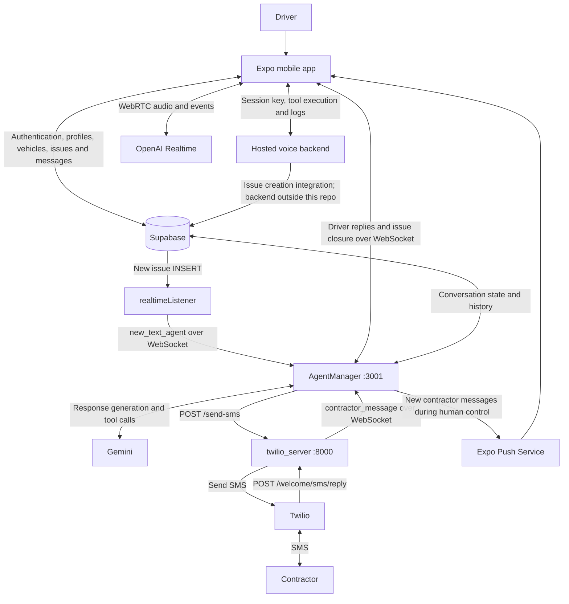

# Text Agent — Driver Breakdown Support

A prototype that helps a driver report a vehicle problem and coordinate help with a contractor. The driver talks to a voice assistant in the mobile app; a separate text agent handles the contractor conversation over SMS. When the text agent needs information it does not have, it hands the conversation back to the driver inside the app.

The product connects three people and interfaces: a driver using the app, an AI assistant coordinating the conversation, and a contractor replying from their normal SMS inbox.

## The product journey

1. **Sign in and load the driver's context.** The Expo mobile app uses Supabase Auth. An approved driver sees their profile, assigned vehicle, latest issue, and older issues. New accounts wait for company approval before accessing the home screen.
2. **Report a problem by voice.** The driver presses **Converse** and describes what has happened. The app sends the driver and vehicle context to the hosted voice backend, gets a temporary session key, and opens a WebRTC audio connection to OpenAI Realtime. Voice tool calls are sent to the hosted backend for execution.
3. **Start contractor coordination from an issue.** The integration point for the text workflow is a new row in Supabase's `driver_issues_agent_table`. It supplies the issue ID, driver ID, issue context, and opening SMS. The voice backend's implementation is outside this repository; its issue-creation tools must be available for a full voice-to-SMS demo.
4. **Contact the contractor by SMS.** The realtime listener detects the new issue and asks AgentManager to create an agent for it. AgentManager sends an introduction identifying it as a virtual agent, followed by the opening message, through the Twilio service.
5. **Handle the conversation automatically.** Contractor replies arrive through a Twilio webhook. AgentManager saves each reply, loads the conversation history, and asks Gemini for a response or a workflow action. The agent's prompt tells it to use the supplied context and hand over rather than invent missing details.
6. **Bring the driver back when needed.** A handover changes `state_controller` from `AGENT` to `HUMAN`. The app then exposes the active issue chat. The driver can read the saved thread and send replies through the same SMS channel; the contractor continues using their SMS inbox.
7. **Close the coordination thread.** The agent can mark the issue complete when the contractor has the information they need, or the driver can mark it resolved from chat. This sets `issue_active` to `false`. In this prototype, closing an issue records the end of the coordination workflow; it does not verify that a vehicle has been repaired.

## Architecture



### Components

| Component | Responsibility | Entry point |
| --- | --- | --- |
| `mobile-app` | Driver signup/sign-in, approval screen, vehicle details, voice reporting, issue history, human chat and push registration. | `App.tsx` |
| `realtimeListener` | Subscribes to new issue rows and forwards them to AgentManager. | `index.js` |
| `AgentManager` | Runs the issue agents, routes contractor replies, saves messages, controls handover/closure, and sends push notifications. | `index.py`, with Gemini logic in `agent.py` |
| `twilio_server` | FastAPI bridge for outbound SMS and inbound Twilio webhooks. | `twilio_server.py` |
| Hosted voice backend | Creates voice sessions, executes voice tool calls, and receives conversation logs. The app currently points to `https://van-mvp-server.onrender.com`. | External to this repository |
| Supabase | Shared authentication, persistent records, and realtime change events. | Existing Supabase project |

The mobile voice integration calls `/realtime/session`, `/tools/execute`, and `/realtime/logs` on the hosted backend. The voice assistant and contractor text agent are separate integrations: OpenAI Realtime handles spoken interaction, while Gemini handles the SMS conversation.

### State and data

| Record | What it stores |
| --- | --- |
| `van_companies` | Companies available during driver registration. |
| `van_driver_user_details` | Driver profile, approval, Expo push token, and activity heartbeat. |
| `van_vehicle_allocations` / `van_vehicles` | The driver's active vehicle assignment and vehicle details. |
| `driver_issues_agent_table` | Issue context, opening message, owning driver, conversation controller, and active/closed state. |
| `driver_conversation_messages` | Messages associated with an issue, with a message ID, timestamp, and `AGENT`, `HUMAN`, or `CONTRACTOR` role. |

Supabase keeps the conversation history across app sessions. The app receives live message inserts and refreshes saved messages when it returns to the foreground or a notification is tapped. AgentManager also keeps live agent instances and contractor-to-issue routing in memory.

## Tech demo walkthrough

Use a pre-approved driver account, an assigned vehicle, and a contractor test phone. Run the local services before creating a new issue.

1. **Show the driver's home screen.** Explain that the assistant starts with the driver's identity and assigned vehicle, while the driver can also see previous issues.
2. **Press Converse.** Report a simple problem, such as: “I have a flat tyre near the north entrance and need someone to help.” Show the spoken exchange. Confirm the hosted voice workflow creates a new issue row.
3. **Show the contractor's phone.** The contractor receives the virtual-agent introduction and opening SMS. Reply with a question whose answer is present in the issue context to demonstrate an automatic response.
4. **Demonstrate handover.** Ask for a detail deliberately absent from the issue context. The intended agent behavior is to transfer control to the driver; verify the issue changes to `HUMAN` and the chat appears in the app.
5. **Reply as the driver.** Send the missing detail from the app and show it arriving in the contractor's SMS inbox. Reply from the contractor phone to show the conversation coming back into the app.
6. **Show a notification if configured.** With the app backgrounded and control set to `HUMAN`, send another contractor SMS. Reopen the app to show the saved conversation catching up.
7. **Close the issue.** Mark it resolved from the app and show its closed status in the issue list.

Allow at least 10 seconds plus model and SMS latency for an automatic response: `AgentManager/agent.py` currently includes a deliberate 10-second wait before generating one. Handover is a model decision, so rehearse the example with the actual issue context.

If the voice backend is unavailable, demonstrate the SMS workflow separately by inserting a valid issue row into the configured Supabase project with `issue_id`, `driver_id`, `driver_issue`, `opening_message`, `state_controller = AGENT`, and `issue_active = true`, plus any other fields required by the live schema. Use a real demo driver ID and a fresh issue ID. This exercises the listener and agent flow without claiming to demonstrate voice intake.

## Running the demo locally

### Prerequisites

- Python 3.12+ for the Python services, Node.js and pnpm for the listener and app, and the Android SDK/JDK for a local Android build.
- An existing Supabase project with the tables above, suitable access policies, and Realtime enabled for the tables the app and listener subscribe to. This repository does not include a database provisioning/migration script.
- Working Gemini credentials, a Twilio account with an SMS-capable number, and access to the hosted voice backend.
- A native development build of the mobile app: it uses `react-native-webrtc`, so Expo Go is insufficient for the voice flow.
- Public tunnels or equivalent routing for Twilio's inbound webhook and the physical phone's connection to AgentManager.

### Environment files

Each component uses its own `.env` file. Use values for the same Supabase project throughout. Keep server credentials in the server components; the mobile app uses the Supabase public/anon key.

**`AgentManager/.env`**

```dotenv
SUPABASE_URL=your_supabase_url
SUPABASE_KEY=your_server_supabase_key
GEMINI_API_KEY=your_gemini_api_key
```

**`realtimeListener/.env`**

```dotenv
NEXT_PUBLIC_SUPABASE_URL=your_supabase_url
SUPABASE_SERVICE_ROLE_KEY=your_supabase_service_role_key
```

**`twilio_server/.env`**

```dotenv
TWILIO_ACCOUNT_SID=your_twilio_account_sid
TWILIO_AUTH_TOKEN=your_twilio_auth_token
```

**`mobile-app/.env`**

```dotenv
EXPO_PUBLIC_SUPABASE_URL=your_supabase_url
EXPO_PUBLIC_SUPABASE_ANON_KEY=your_supabase_anon_key
EXPO_PUBLIC_ISSUE_CHAT_WEBSOCKET_URL=wss://your-agentmanager-tunnel-host
```

AgentManager currently binds to `localhost:3001`. Point a WebSocket-capable tunnel at that port and use its `wss://` address in the mobile configuration. A phone's `localhost` refers to the phone itself, not the development computer.

### Install dependencies

Run each block from the repository root. The examples use PowerShell; skip virtual environment creation if you already have one and use its interpreter instead.

```powershell
cd AgentManager
py -3.12 -m venv venv
.\venv\Scripts\python.exe -m pip install -r requirements.txt
```

```powershell
cd twilio_server
py -3.12 -m venv venv
.\venv\Scripts\python.exe -m pip install -r requirements.txt
```

```powershell
cd realtimeListener
pnpm install
```

```powershell
cd mobile-app
pnpm install
```

The mobile app's `pnpm-workspace.yaml` selects `nodeLinker: hoisted` to shorten native dependency paths for Windows builds.

### Start services in separate terminals

Run each block from the repository root and leave the terminal open.

**1. AgentManager — WebSocket server on port 3001**

```powershell
cd AgentManager
.\venv\Scripts\python.exe index.py
```

**2. Twilio bridge — HTTP server on port 8000**

```powershell
cd twilio_server
.\venv\Scripts\python.exe -m uvicorn twilio_server:app --host 127.0.0.1 --port 8000
```

Expose port 8000 through an HTTPS tunnel. In the Twilio number's incoming-message configuration, set the webhook method to **POST** and the URL to `https://your-tunnel-host/welcome/sms/reply`. Outbound SMS uses the local `/send-sms` endpoint; inbound replies need this public webhook.

**3. Supabase issue listener**

```powershell
cd realtimeListener
node index.js
```

**4. Mobile app on a connected Android device**

```powershell
cd mobile-app
pnpm exec expo run:android --device
```

If the native development build is already installed and native dependencies have not changed, start Metro with `pnpm start:dev-client` from `mobile-app` instead.

### Before presenting

- Confirm the approved driver can sign in and has the expected vehicle assignment.
- Confirm the hosted voice backend is responsive and its tool workflow can create the expected Supabase issue row.
- Check `agent_phone_number` and `contractor_phone_number` in `AgentManager/index.py`: the prototype uses fixed numbers. Use the intended Twilio sender and demo recipient, including any Twilio trial-account recipient verification.
- Confirm the listener connects to AgentManager before creating the demo issue. It handles new inserts, not a backlog of existing issues.
- Confirm the Twilio webhook and mobile WebSocket tunnel URLs are current. Test a full SMS round trip.
- For push notifications, use a configured native build/device, grant permission, and confirm the driver's Expo token is saved. Push delivery is optional to the core SMS demo.

## Current prototype boundaries

- **One contractor conversation at a time is the reliable demo scope.** Agent instances are indexed by issue ID, but phone numbers are fixed and contractor-number routing can be overwritten by another issue.
- **AgentManager needs to stay running throughout the demo.** Messages persist in Supabase, but live agent instances and routing are not restored automatically after a restart.
- **The listener has no replay queue.** A new issue can be missed if its WebSocket connection is unavailable. Start it before creating the issue.
- **Human chat depends on a reachable AgentManager socket.** Supabase supplies saved history and live message updates; sending replies and closing an issue use WebSocket commands.
- **Notifications currently apply to contractor messages during human control.** The backend does not currently suppress them based on recent foreground activity; the heartbeat-based suppression logic is commented out.
- **The voice service and database are external dependencies.** This repository contains the mobile integration and SMS services, rather than the hosted voice backend or a complete infrastructure setup.

## Code map for technical questions

- [Voice connection, tool execution and transcript events](mobile-app/src/components/webRtc.tsx)
- [Authentication, driver/vehicle loading and realtime issue updates](mobile-app/src/features/auth/AuthContext.tsx)
- [Driver home screen and notification registration](mobile-app/src/features/driver/DriverHomeScreen.tsx)
- [Saved chat history, live messages, driver replies and issue closure](mobile-app/src/components/CurrentIssueChat.tsx)
- [New-issue subscription and agent startup event](realtimeListener/index.js)
- [Agent routing, issue state, message persistence and handover](AgentManager/index.py)
- [Gemini responses and workflow tool calls](AgentManager/agent.py)
- [Outbound SMS and inbound reply webhook](twilio_server/twilio_server.py)
- [Expo push delivery](AgentManager/expo_push_notification_functionality.py)
